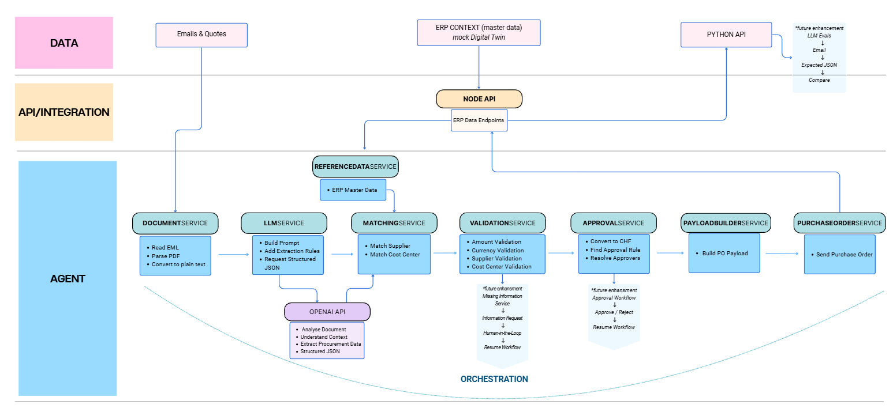

# ProcurmentAgent
The project automates the process of converting unstructured procurement requests from emails and supplier quotes into structured purchase orders.

 

The solution is organized into three layers: Data, API/Integration and Agent Orchestration. The Data Layer contains unstructured procurement inputs (emails and supplier quotes) as well as ERP master data. The API/Integration Layer exposes ERP reference data and purchase order endpoints. The Agent Orchestration Layer coordinates the end-to-end workflow, including document processing, LLM-based information extraction, ERP entity matching, business validation, approval determination and purchase order generation. By combining AI-powered document understanding with ERP context, the agent can transform unstructured procurement requests into structured purchase orders ready for submission. Future enhancements include human-in-the-loop handling for missing information, approval workflow execution and LLM evaluation capabilities.

